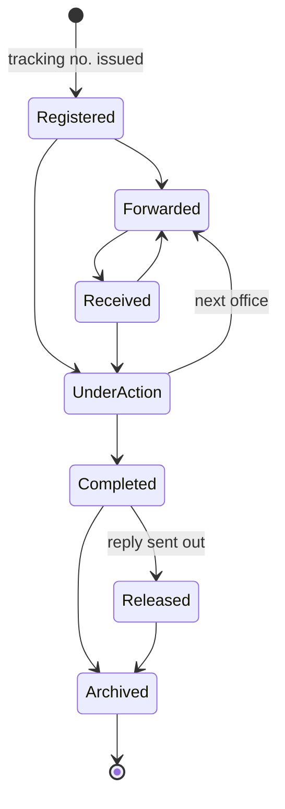
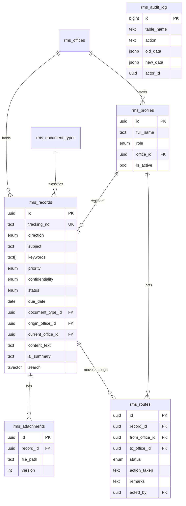

# System analysis and design

## Purpose and scope

Baguio RMS registers, routes, tracks and reports on every document that enters or leaves a city government office. It replaces paper logbooks with one searchable record per document, a full movement history and role-based access. The scope is the eight modules in the job description: registration, classification and indexing, document storage, search, status and history, actions and remarks, user access, and reports.

Out of scope for the demo: digital signatures, integration with national systems, physical archive inventory.

## Users and use cases

| ID | Use case | Actor |
| --- | --- | --- |
| UC-01 | Log in, log out | All users |
| UC-02 | Register an incoming record and attach the scan | Records Officer |
| UC-03 | Register an outgoing record | Records Officer, Department Staff |
| UC-04 | Classify and index a record | Records Officer |
| UC-05 | Forward a record to another office | Records Officer, holding office |
| UC-06 | Receive a forwarded record | Holding office |
| UC-07 | Record an action taken and remarks | Holding office |
| UC-08 | Complete, release or archive a record | Records Officer (archive), holding office |
| UC-09 | Search and view a record, its files and timeline | All users, within access |
| UC-10 | Print a routing slip with QR code | Records Officer |
| UC-11 | View dashboard and export reports | Department Head, Records Officer, Admin |
| UC-12 | Manage users, roles and offices | Admin |
| UC-13 | Review the audit log | Admin |
| UC-14 | Ask the records assistant | All users, within access |
| UC-15 | Delete a record to the bin; restore it | Records Officer (delete), Admin (delete, restore) |
| UC-16 | Review access history and run a "who accessed this person's records" report | Admin |
| UC-17 | Turn on two-step sign-in; unlock a locked account; change security settings | All users (two-step), Admin (unlock, settings) |

## Access matrix

Each record has a level: **Public** (any signed-in user may read it), **Internal** (the offices that handled it) or **Confidential** (records desk, admin and the department head of the office holding it).

| Permission | Admin | Records Officer | Department Head | Department Staff | Viewer |
| --- | --- | --- | --- | --- | --- |
| Register incoming | Yes | Yes | No | No | No |
| Register outgoing | Yes | Yes | Own office | Own office | No |
| Forward, receive, act, remark, attach | Any record | Any record | Held by own office | Held by own office | No |
| View Public records | All | All | All | All | All |
| View Internal records | All | All | Own office + routed to it | Own office + routed to it | Own office + routed to it |
| View Confidential records | All | All | Own office | No | No |
| Delete to bin / restore | Both | Delete | No | No | No |
| Reports | All | All | Own office | No | Own office |
| Users, settings, audit log, access history | Yes | No | No | No | No |

## Status lifecycle

Every arrow writes one row to `rms_routes` (who, which office, when, action taken, remarks). A record past its due date that is not completed is flagged overdue.

## Entity relationship diagram

`rms_audit_log` is filled by triggers on every other table and is hash-chained; a trigger refuses updates and deletes. `rms_access_log` records sign-ins, views and downloads; `rms_settings` holds the security settings.

## Non-functional requirements

- **Security:** row-level security on every table; the app uses the user's own session, never a service key; attachments in a private bucket; admin-only account creation.
- **Data Privacy Act (RA 10173):** only fields needed for tracking are collected; privacy notice accepted at every sign-in; personal names masked in lists and exports; confidential records hidden from users without access, including from search and the assistant.
- **Auditability:** append-only, hash-chained audit log with old and new values, actor and IP for every change, download and AI suggestion.
- **Usability:** works on desktop and phone browsers; printable routing slips and reports.

## Security and privacy controls

| Control | How it works | Where it is enforced |
| --- | --- | --- |
| Tamper-evident audit log | Every insert, update, delete, download and AI suggestion is written by a trigger with who, what, when and IP. Each entry stores a SHA-256 fingerprint of the previous one; the Audit log page re-checks the whole chain. Update, delete and truncate are refused by a trigger. | `rms_audit_log`, `rms_audit_chain()`, `rms_verify_audit_chain()` |
| Access history | Sign-ins, failed attempts, lockouts, sign-outs (incl. idle), records opened and files downloaded, filterable by user, record and event. Append-only. | `rms_access_log`, `rms_log_access()` |
| Roles and record levels | Five roles; Public / Internal / Confidential per record. Viewer is read-only. | RLS policies, `rms_can_view()` |
| Sign-in protection | 5 wrong passwords lock the account for 15 minutes (adjustable); a locked user's database role is void even with a live session. Idle sign-out after 15 minutes. Optional TOTP two-step sign-in; an admin who turns it on gets no admin powers until the code is entered (`aal2`). | `rms_login_check/failed/succeeded()`, `rms_my_role()`, `IdleLogout`, `/mfa` |
| Protected files | Private bucket; downloads pass through the server, are logged, and PDFs and images come stamped "Viewed by name, date". With stamping off, links expire in 60 seconds. | `/api/attachments/[id]`, `lib/watermark.ts` |
| Soft delete | Records go to a bin with a reason; hidden from everyone but admins; only an admin restores. The deleted columns can only change through the two functions. | `rms_delete_record()`, `rms_restore_record()`, guard trigger |
| AI guardrails | The assistant searches as the user. With "keep Confidential out of AI" on (default), confidential records are excluded from assistant search, details and summaries. A "do not send to AI" box skips AI reading for sensitive scans. | `askAssistant()`, `/api/ai/summary`, settings |
| Privacy touches | Privacy notice at sign-in; names masked in lists and CSV ("J*** dela C***"); report of who opened or downloaded records naming a person. | `maskName()`, `rms_person_access_report()` |

## AI design

| Feature | Model | Safeguard |
| --- | --- | --- |
| Scan-to-prefill | Claude Haiku 5.5, structured output | Officer confirms highlighted fields; suggestion logged |
| Plain-language search | Claude Haiku 5.5, structured output | Resulting filters shown and editable |
| Record summary | Claude Haiku 5.5 | Logged; saved only with edit rights |
| Records assistant | Claude Haiku 5.5 with two search tools | Tools run as the user, so access rules apply; Confidential excluded by default; answers link the records used |

For on-premise use, the four calls can point to a locally hosted open-weight model.
